# Using the App from the web interface

How to use `lock_in+pid_square` ("Square Lock-in+PID") **v2.0.11** (branch `master`) from the browser, panel by panel, and the usual
procedures: scan, see a peak, get an error signal with the square lock-in, close a lock and check it. Technical data
of each instrument is in [App.md](App.md); registers in [FPGA.md](FPGA.md); how the page talks to the board in
[Structure.md](Structure.md).

- [Opening the App](#opening-the-app)
- [Layout of the page](#layout-of-the-page)
- [Panels](#panels)
  - [Toolbar](#toolbar) ([Reset zoom: whole period / rising half](#reset-zoom-whole-period--rising-half)) ·
    [Oscilloscope](#oscilloscope) · [Outputs](#outputs) · [Lock-in modules](#lock-in-modules) ·
    [Ramp Controller](#ramp-controller) ([Tabs period and freq](#tabs-period-and-freq), [Lock osc. screen](#lock-osc-screen)) ·
    [PIDs modules](#pids-modules) · [Lock Control](#lock-control) · [Streaming](#streaming) ·
    [Right panels and displays](#right-panels-and-displays) · [Slow scans](#slow-scans)
- [Typing values with units](#typing-values-with-units)
- [Procedures](#procedures)
  1. [Scan and see the response of the system](#1-scan-and-see-the-response-of-the-system)
  2. [Configure the square lock-in to get an error signal](#2-configure-the-square-lock-in-to-get-an-error-signal)
  3. [Close the lock (Trigger Lock / Lock Now)](#3-close-the-lock)
  4. [Check the lock and release it](#4-check-the-lock-and-release-it)
  5. [Working at 31.25 MHz](#5-working-at-3125-mhz)
- [Saving and loading configurations](#saving-and-loading-configurations)
- [Saving data](#saving-data)
- [Several clients and Restart](#several-clients-and-restart)
- [Known limitations of the interface](#known-limitations-of-the-interface)

**Screenshots.** Taken on RP2 (RedPitaya_OS 2.04-35) with a simulated peak made by `dummy_simulator` on a second
board. With this App: v2.0.4-13 (2026-10-16: the Oscilloscope, Ramp, PIDs, PID A, Lock Control panels, the Lock-in
modules panel and the Fire on click GIF, with `test_files/lock_in+pid_square__lock_mode.json`), and the `sq_*` of
2.0.0-5 / 2.0.0-6 (board tests of 2026-10-12, `reportes/lock-in_pid_sq.md` and `reportes/lock-in_pid_sq_lock_test/`
in the Apps folder), and v2.0.10-20 (2026-11-13: the *Ramp Controller* tabs, *Lock osc. screen*, *Reset zoom* and the
31.25 MHz lock in Auto; board test `reportes/lock-in_pid_sq/2026-11-13_1503_v2010.md`). In the screenshots of v2.0.10
the ramp was internal (not sent to OUT1), so Channel 1 (in1) shows only the noise of the bench. Some screenshots taller
than the browser window are two screenshots of the same page joined.
A few dialogs and fields that this App inherits unchanged from `lock_in+pid_harmonic` (Streaming, Choose from graph
warning, Time trigger with units, Config, Restart) are shown with screenshots of that App (v2.3.10–2.3.17): the title
of the page and the names of the lock-in signals in the selectors are different (`Xo`/`Yo` there, `sqXo`/`sqYo`
here), the rest is identical. Their captions say so.

## Opening the App

Install the App (see the [README](../README.md#installation)) and open
`http://rp-XXXXXX.local/lock_in+pid_square/` (or choose *Square Lock-in+PID* in the main menu of the Red Pitaya).
The page starts the App (loads the FPGA and the C controller) and restores the last settings used in this browser (any tab) when **Load last config on init** is checked
(default, Config dialog, since v2.0.6); unchecked, the App starts with its default parameters (see [Saving and loading
configurations](#saving-and-loading-configurations)). If the App is already running (e.g. another tab), the page shows its current state. Use a single tab per board (see [Several clients and Restart](#several-clients-and-restart)).

After loading, the FPGA has its reset values: square generator at **31.25 MHz** (`gen_mod_sqp` = 1), modulation off on
both outputs (`mod_out1` = `mod_out2` = −1), OUT1 = OUT2 = 0, lock-in filters 8 µs 2nd order, gains ×1, ramp off
(defaults checked on the board, `reportes/lock-in_pid_sq.md` step 1).

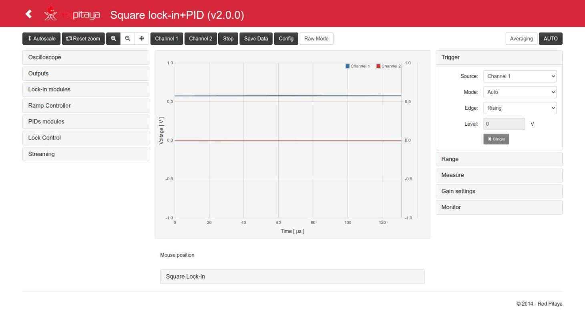

## Layout of the page

- **Top toolbar**: zoom and acquisition buttons.
- **Left column**: the instruments (Oscilloscope, Outputs, Lock Control, Lock-in modules, Ramp Controller, PIDs
  modules, Streaming; Lock Control is below Outputs since v2.0.6). Each title opens or closes its panel.
- **Centre**: the plot (two Y axes, Channel 1 blue and Channel 2 red), the mouse position, and the
  **Square Lock-in** display (sqX, sqY, R, φ, sqF), opened with its title.
- **Right column**: the original scope controls (Trigger, Range, Measure, Gain settings) and the Monitor.

Every change is sent to the board when the field loses focus or Enter is pressed (Escape cancels the edit).
Only changed values are sent. A field left empty (e.g. after Backspace) or with an invalid text is **not** sent:
the last value comes back.

## Panels

### Toolbar

| Button | Action |
|---|---|
| Autoscale | Rescales the **Y axis** to the data on screen, only in the page. Does not end a lock capture. |
| Reset zoom, zoom in/out, pan | Plot navigation. A zoom selects the time window of the acquisition (the decimation is chosen from it). Reset zoom (v2.0.3) sets the window from t = 0 to one period of the ramp (Ext Trig = Scan floor / Scan ceil; with Scan floor and a triangle, a second click gives the rising half, [below](#reset-zoom-whole-period--rising-half); with *Lock osc. screen* on, its window), one period of the square modulation (Ext Trig = Square mod., 2·(sqp+1) ticks) or one whole memory at the current decimation (otherwise), and Y to −1 … 1 V (raw mode −8192 … 8192). Periods of 1.5 s or more: 0.98 × the period, so that every scan is acquired ([Slow scans](#slow-scans)). During a lock capture it first ends it, as AUTO, and uses the restored Ext Trig. The Raw Mode button rescales Y the same way. |
| Mouse wheel on the plot (v2.0.3) | Zoom centred on the mouse, 1.5× per step. **No key:** both axes (time and the two Y axes). **SHIFT** held: time axis only (the cursor becomes a horizontal double arrow ↔). **ALT** held: Y axes only (vertical double arrow ↕; in raw mode the Y range is in counts). The time window is sent to the controller once the wheel stops (250 ms), which chooses the decimation as for any zoom; it stays between 20 ns and 68.7 s. The Y zoom is only in the page (1/2048 … 1000 × full scale). During a lock capture the wheel zoom is only in the page; ending the capture restores the window saved before it. The wheel on the number fields is not affected (SHIFT ×10, CTRL ×100). With *Lock osc. screen* on (v2.0.10) the wheel without keys zooms Y only and the time zoom (SHIFT, box, X±) changes the ramp limits instead ([Lock osc. screen](#lock-osc-screen)). |
| Channel 1 / Channel 2 | Show or hide each channel. |
| Stop | Stops the acquisition. |
| Save Data | Plot data as Python/Numpy, Matlab/Octave or CSV ([Saving data](#saving-data)). |
| Config | Save / load configurations ([below](#saving-and-loading-configurations)). |
| Raw Mode | Values in counts (`int`) instead of volts (also in the Square Lock-in display). Also the *Level* of the scope trigger (field, slider and line; −8192 … 8191, unit `counts`): switching Raw Mode converts it (counts = V × 8192 / full scale) and sets Y to −8192 … 8192 / −1 … 1 V. Before v2.0.8 the level in Raw Mode was taken as volts by the controller (Normal / Single did not trigger). |
| Averaging | Average inside the decimation. |
| **AUTO** | Auto-set of the scope in the controller (time range, trigger, Y range). Ends a lock capture. Not the same as *Autoscale*. The minimum window it chooses is 1 µs. The trigger level is set to the middle of the signal (since v2.0.9 also with a calibration offset of the input; whole counts in Raw Mode). |

#### Reset zoom: whole period / rising half

Since v2.0.10 (port of `lock_in+pid_harmonic` 2.3.31 / `lock_in+pid_plus` 2.2.0), with *Source* = External, *Ext
Trig* = **Scan floor** and a **triangle** ramp (and *Lock osc. screen* off), **each click of Reset zoom alternates**
between the whole period and the rising half (`resetZoomCycleNext()`, `index.html` l. 3506, used by `resetZoom()`,
l. 6455):

1. first click: 0 … T (one whole period, as before; 0 … 0.98 T for T ≥ 1.5 s, see [Slow scans](#slow-scans));
2. next click: **0 … T/2**, the rise from the scan floor to the top (a triangle always rises after the floor,
   [App.md](App.md#ramp-generator-scan));
3. next click: whole period again, and so on, while the zoom is not touched.

Anything else in between starts the cycle again, so the next click gives the whole period: a zoom by hand (box, wheel
with or without SHIFT / ALT, pan, X± / Y±, Autoscale, the scope presets), a change of the trigger (*Source*, *Mode*,
*Ext Trig*, *Edge*) or of the ramp (any tab, the checkboxes, the zoom of *Lock osc. screen*, another client, a config
load: the parameters are compared too), or a window on the plot different from the one of the last click.

With *Scan ceil* (its first half after the trigger is the fall), a **sawtooth**, another *Ext Trig* or *Source*, Reset
zoom gives one period / one memory on every click, as before; with *Lock osc. screen* on, it gives the window of Lock
osc. screen. With **Ext Trig = Square mod.** it still gives **one period of the square modulation**, 2·(`gen_mod_sqp`+1)
ticks (`sqPeriodCycles()`, l. 3441), on every click, without alternating. The tooltip of the button says so: "X: one
period of the ramp (Ext Trig = Scan floor / Scan ceil), one period of the square modulation (Ext Trig = Square mod.)
or one whole memory of the scope at the current Dec (otherwise), from t = 0. Source External + Scan floor + triangle: a
second click (zoom not touched) gives the rising half of the ramp, and the clicks alternate. With Lock osc. screen:
its window. Y: -1 V .. 1 V (raw mode: -8192 .. 8192)" (l. 7431).

Measured on the board (v2.0.10, ±4000 at 100 Hz, triangle): five clicks gave 0 … 9.984 / 4.992 / 9.984 / 4.992 /
9.984 ms; after a wheel zoom the next click gave 9.984 ms again and the following one 4.992 ms; sawtooth: 3 of 3 clicks
the whole period (9.985 ms); Scan ceil: 3 of 3 clicks 9.984 ms. *Square mod.*: `gen_mod_sqp` 1 (31.25 MHz, 4 ticks)
→ 0 … 0.032 µs, `gen_mod_sqp` 49 (1.25 MHz, 100 ticks) → 0 … 0.8 µs, the same on both clicks.

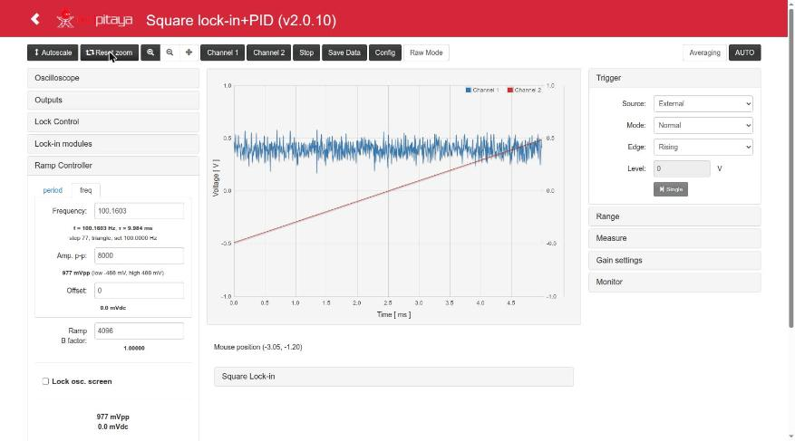

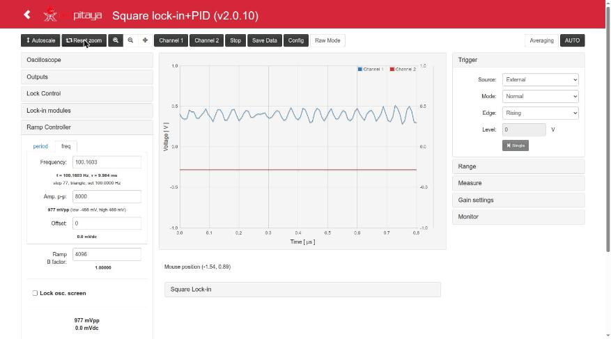

When a click changes the time units (e.g. from a window in seconds to ms) the server repeats the new window in every
`GET /data` until the next POST; since v2.0.10 the page applies that once and never over a window that it has just
set itself ([Structure.md](Structure.md#time-window-of-the-plot-and-force-x)). Board test: 10/10 second clicks from
an axis in seconds (−0.73 … 0.73 s), waiting 0 to 12 s between the two clicks, stayed at 0 … 4.992 ms, also 3 s and 6 s
later.

### Oscilloscope

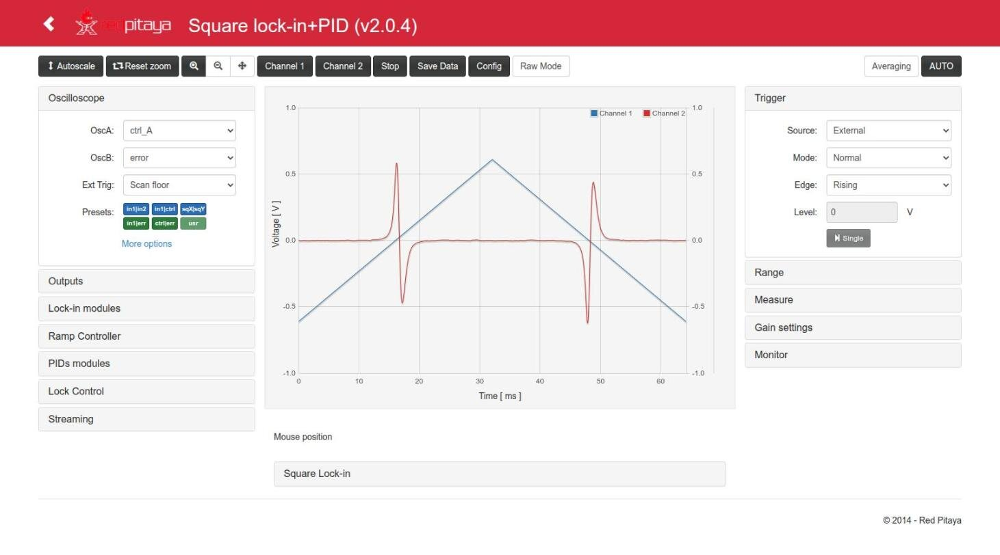

In the screenshot (`lock_mode`, no lock): OscA = ctrl_A, OscB = error (sqYo), Ext Trig = Scan floor (with the row of
*Presets*), Trigger External / Normal, after *Reset zoom* (0 … 64.16 ms): the triangle of the ramp and the error with
its zero crossings at ≈ 16.6 ms and ≈ 48 ms (one per peak, on the way up and on the way down).

- **OscA / OscB**: signal shown on Channel 1 / Channel 2, any of 21 internal signals: 0, in1, in2, error, ctrl_A,
  ctrl_B, Ramp A, Ramp B, pidA_in, pidB_in, PID A out, PID B out, **sq_ref, sq_quad, sq_phas, sqXo, sqYo, sqFo**,
  signal_i, out1, out2 ([values](FPGA.md#oscilloscope-channels-osca_sw-oscb_sw)). The fast inputs are seen with
  `in1`/`in2`; the references are ±4096 counts (±0.5 V on the plot).
- **Ext Trig**: event used when the scope trigger *Source* is *External*: None, Pin (DIO0_P), Scan floor,
  Scan ceil, **Square mod.** (one pulse per period of the square generator, at the rising edge of `sq_ref`), Out of
  lock, Jump trigger, Lock control trig (the lock event; used by Capture Lock). With *Square mod.* the edge of
  `sq_ref` falls on the same sample in every acquisition (8/8 on the board at 50 kHz and 31.25 MHz).
  Since v2.0.4, picking an Ext Trig other than the current one and not *None* also sets the *Trigger* panel to
  *Source* = External and *Mode* = Normal (one POST). *None* changes nothing else; *Config load*, the end of a
  Capture Lock, *Reset zoom* and *AUTO* keep their own trigger settings.
- **Presets** (v2.0.4): small buttons below Ext Trig that set OscA|OscB in one click: `in1|in2`, `in1|ctrl`
  (in1, ctrl_A), `sqX|sqY` (sqXo, sqYo) in blue; `in1|err` (in1, error), `ctrl|err` (ctrl_A, error) and `usr` in green.
  They change only the two signals: not the zoom, not the trigger, not a lock capture. `usr` is a pair of your
  own: **double click** on it (or a click while it is not configured; dashed border) opens a dialog with the two
  signals (any signal of the selects); *Accept* saves it in the browser and shows it. The pair is also saved in the
  configs (*Config*: save and download; older configs without it keep the current one). The tooltip of each button
  names its two signals.
- **More options**: *R|Phase Mode* (disabled in this version) and *Disable anti-aliasing filter* for each
  channel.

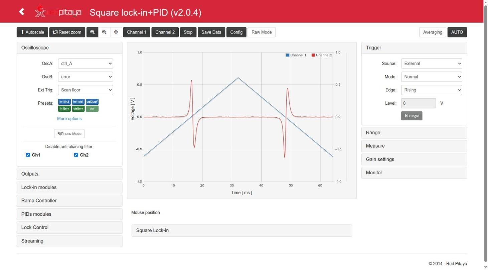

### Outputs

- **Out1 / Out2**: signal sent to each fast output (±1 V): 0, in1, in2, in1−in2, error, sq_ref, sq_quad, sq_phas,
  sqXo, sqYo, PID A out, PID B out, ctrl_A, ctrl_B, aux_A, aux_B. For a lock, Out1 = ctrl_A (ramp + PID A) is the
  usual choice; the square modulation is **added** to it with *A Out1* ([Lock-in modules → Auxiliar](#lock-in-modules)).
- **Slow outputs**: four selectors. **They have no effect in this version** (the slow outputs are not driven by
  the FPGA, see [App.md](App.md#inputs-and-outputs)); their option lists still show the names of the harmonic App
  (`sin_ref`, `cos_1f`...).

(No screenshot of this panel with this App yet; it is the panel of lock_in+pid_harmonic with the option list
above.)

### Lock-in modules

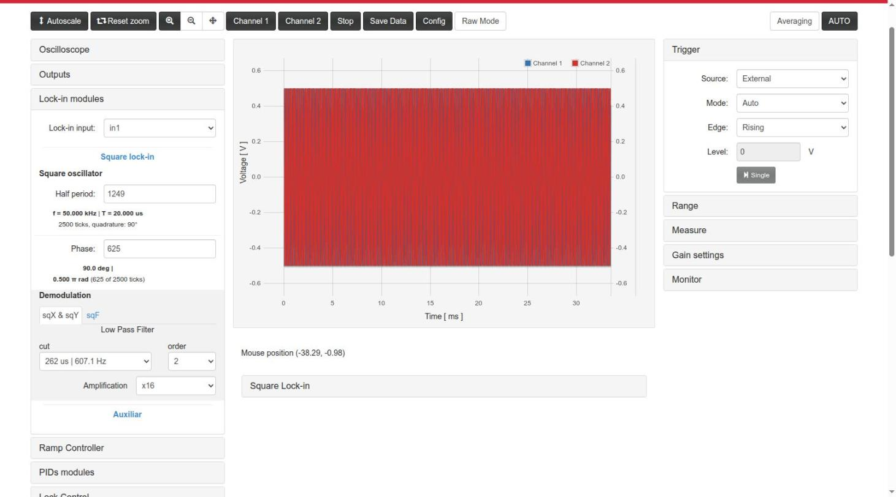

In the screenshot (v2.0.4): Half period 1249 (f = 50.000 kHz, T = 20.000 µs, quadrature 90°), **Phase 625** (90.0°,
0.500 π rad), sqX & sqY filter 262 µs | 607.1 Hz order 2, **×16**; preset `sqX|sqY`, Normal / Scan floor, Reset zoom
(0 … 64.16 ms): sqYo (±0.3 V) and sqXo (±0.13 V) are dispersive at the two peaks. These Phase and gain values were
set only for this screenshot: the test configuration `lock_mode` uses Phase 0 and ×32 ([procedure 2](#2-configure-the-square-lock-in-to-get-an-error-signal)).

- **Lock-in input** (`signal_sw`): signal to demodulate: in1, in2, in1−in2, sq_ref, sq_quad, sq_phas, aux_A, Ramp A.
  `sq_ref`/`sq_quad` as input are useful to check the lock-in without external signal (sqX of `sq_ref` = 4096 ×
  gain).
- **Square lock-in** (opened with its title):
  - **Square oscillator**:
    - **Half period** (`gen_mod_sqp`, half period − 1 in ticks of 8 ns): f = 125 MHz / (2·(value + 1)).
      Accepts a number, a frequency (`50 kHz`, `31.25 MHz`) or a period (`20 us`) ([units](#typing-values-with-units)).
      Below it the page shows **f**, **T**, the ticks per period and the **quadrature angle**: 90° when the value is
      odd; with an even value it shows the real angle in orange, e.g. "quadrature: 60.0° (use an odd value for 90°)"
      for 2, and "none (62.5 MHz)" for 0. The mouse wheel changes it by one and updates the text.
    - **Phase** (`gen_mod_phase_sq`): delay of `sq_phas` (and of the sqF demodulation) with respect to `sq_ref`, in
      ticks, or an angle (`90 deg`, `0.5 pi`, `1.57 rad`) or a delay (`5 us`). Below: degrees, fraction of π and
      "n of P ticks"; values ≥ P are marked "limited to P-1" (the FPGA uses P−1). At 31.25 MHz there are only 4
      ticks per period: 0, 90°, 180°, 270°.
  - **Demodulation**, two tabs:
    - **sqX & sqY**: low-pass filter shared by sqX (from `sq_ref`) and sqY (from `sq_quad`): *cut* = τ | f (28
      values, 64 ns | 2.5 MHz … 9 s | 18.5 mHz) and *order* (OFF, 1, 2); **Amplification** ×1 … ×32k of sqXo and sqYo.
    - **sqF**: the same for sqF (from `sq_phas`).
- **Auxiliar** (opened with its title): *Aux A*, *Aux B* constants (−8192..8191), and **Square Modulation
  Amplitude**: *A Out1* adds ±A/2 with `sq_ref` to OUT1, *A Out2* adds ±A/2 with `sq_quad` to OUT2; −1 = off,
  0..8191 (A = 8191: ±0.5 V). A = 100 adds ±50 counts (±6.1 mV).

With OscA = `sq_ref` and OscB = `sq_phas` (Phase = 626 ticks at 50 kHz) the delay between the two references is
seen directly:

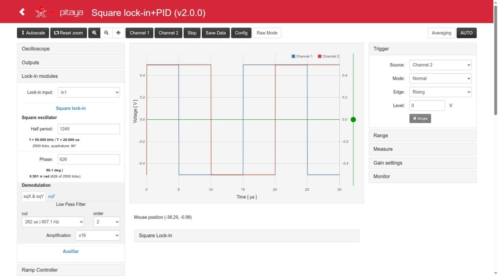

### Ramp Controller

Since **v2.0.10** (the Ramp Controller of `lock_in+pid_plus` 2.2.0, ported through `lock_in+pid_harmonic` 2.3.31; web
page only) the panel has two tabs, *period* and *freq*, and a *Lock osc. screen* option. The ramp of the FPGA
(`gen_ramp.v`, the same file as in those Apps) and its registers are the same as before (CHANGELOG v2.0.10). The
relation between the registers and the physical ramp (period, frequency, amplitude, offset) is in
[App.md](App.md#ramp-generator-scan).

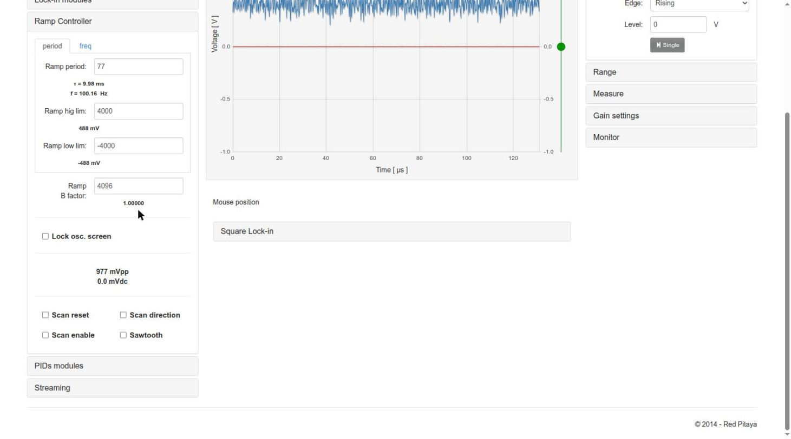

Layout of the panel (top to bottom, `index.html` l. 8620-8816):

- the tabs **period | freq**; the fields of the active tab are inside a box closed by the grey line of the tabs
  (1 px `#dddddd`, CSS `.ramp-tab-pane`, l. 37-46), so it is clear which controls belong to the tab;
- **Ramp B factor** (4096 = 1: ratio of Ramp B to Ramp A; outside the tabs, as before);
- **Lock osc. screen** (checkbox, between two separators, with a short status text below);
- the amplitude (mVpp) and centre (mVdc) of the ramp;
- the four checkboxes in **two columns**: *Scan reset* / *Scan enable* on the left, *Scan direction* / *Sawtooth* on
  the right. *Scan reset* holds the ramp at 0; *Scan enable* runs it (the *Scan enable* button of Lock Control must
  also be on); *Scan direction* is the direction of the sawtooth (a triangle always rises after the scan floor, see
  [App.md](App.md#ramp-generator-scan)); *Sawtooth* unchecked = triangle.

Labels in mV that round to zero show "0 mV", never "-0 mV" (`toFixedNz()`, l. 2100; also Vtrg of the
lock trigger). On the board (v2.0.10) limits of −2 counts and a level trigger of −2 counts show "0 mV".

#### Tabs period and freq

Only the active tab is visible, so there is only one way of editing the ramp at a time. Clicking the other tab
first applies the edit in progress (as leaving the field) and then **loads the fields of the new tab from the
parameters of the board** (including changes made by another client or a config load); `rampTabSet()`,
`index.html` l. 3793. The last tab used is kept in the browser (`localStorage`, key
`lockin_ramp_tab_lock_in+pid_square`, `ramp_tab_key` l. 3769) and comes back after a reload.

**Tab period**:

| Field | Units | What it does |
|---|---|---|
| **Ramp period** | `ramp_step` (clock ticks per step − 1), or **the whole period** with a unit: `s`, `seg`, `ms`, `us` (`10 ms`, `0.5 s`, `10ms`; decimal point or comma) | A number alone is the step. A period is converted to the step whose whole period *T* (below) is the nearest one (`rampStepForPeriod()` / `rampParseStep()`, l. 3566-3587) |
| **Ramp hig lim**, **Ramp low lim** | counts (8192 = 1 V) | Limits of the ramp. Below each field: the limit in mV. They do not accept `mV` / `V` from the page (see [Known limitations](#known-limitations-of-the-interface)); the *freq* tab does |

The period of *Ramp period* is that of the whole ramp, from scan floor to scan floor:

$$
T = N\,(\mathrm{step}+1)\cdot 8\ \mathrm{ns},\qquad N = \begin{cases} 2\,(\mathrm{hig}-\mathrm{low}) & \text{triangle}\\ (\mathrm{hig}-\mathrm{low})+1 & \text{sawtooth} \end{cases}
$$

so it depends on the limits and on the waveform.

- **Enter or leaving the field** sends the value (one POST) and rewrites the field in steps (`77`, `3905`…). While
  typing nothing is sent; the text below already shows the τ / f of what is typed (a preview). Escape restores the
  previous value.
- A text that is not valid (`10 kg`, `abc`, a negative value), or a period with *Ramp hig lim* = *Ramp low lim*, is
  not sent: a red hint appears below ("? steps, or a period with units: s, ms, us" or "? a period needs Ramp hig
  lim &gt; Ramp low lim", l. 2166-2167) and the last value comes back.
- The step is limited to **0 … 2147483520** ($2^{31}-128$, `ramp_step_max`, l. 3544) and rounded as the float32
  parameter of the controller (above $2^{24}$ only every 2nd, 4th … 128th integer exists): `4294967295` or `1e6 s`
  give 2147483520.
- Mouse wheel ±1, SHIFT ×10, CTRL ×100, both ×1000 (above $2^{24}$ the wheel ±1 does not move the step, see
  [Known limitations](#known-limitations-of-the-interface)).
- Below the field: τ (the whole period) and f of the ramp.
- Checking or unchecking *Sawtooth* with the *period* tab active keeps the step, so the period changes (77 with ±4000:
  9.98 ms in triangle, 4.99 ms in sawtooth).
- No tooltip on the label nor the input; a click on the label "Ramp period" opens the help (l. 2028).

Up to v2.0.9 the field was an `<input type="number">`, so a period with units never reached the page, and the old
conversion took (hig − low) steps, half the period of a triangle; the τ of a sawtooth was one step short.

Measured on the board with v2.0.10 (triangle / sawtooth ±4000, report `reportes/lock-in_pid_sq/2026-11-13_1503_v2010.md`
in the Apps folder): `10 ms` + Enter → step 77 in triangle (τ = 9.98 ms), 155 in sawtooth (τ = 9.99 ms); `4294967295` →
2147483520 (also in sawtooth); `10 kg` restores the value; no POST while typing, one with Enter. The periods measured
on the scope trace with the same page code and the same `gen_ramp.v` (`lock_in+pid_plus` 2.2.0-rc2,
`reportes/lock-in_pid_plus/2026-11-13_0747_v220rc2.md`):

| Waveform, limits (N) | Typed | Step | T | T measured |
|---|---|---|---|---|
| triangle ±4000 (16000) | `10 ms` | 77 | 9.984 ms | 9.98396 ms |
| triangle ±4000 | `0.5 s` | 3905 | 499.968 ms | 0.49998 s |
| sawtooth ±4000 (8001) | `10 ms` | 155 | 9.9852 ms | 9.98526 ms |
| sawtooth ±4000 | `0.5 s` | 7811 | 500.03 ms | 0.49999 s |
| triangle 1000 / −3000 (8000) | `10 ms` | 155 | 9.984 ms | 9.98399 ms |
| sawtooth 1000 / −3000 (4001) | `10 ms` | 311 | 9.9865 ms | 9.98672 ms |

**Tab freq**:

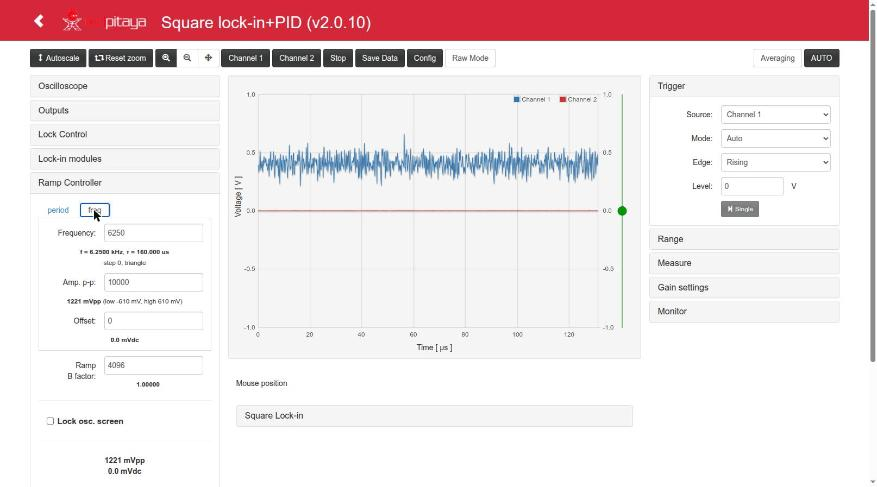

| Field | Units | What it does |
|---|---|---|
| **Frequency** | Hz, or with units: `2.5 kHz`, `10 Hz`, `500 mHz`, `1e3`, `1.5M` (`parseRampFreq()`, l. 3640; `abc`, `-5` are rejected) | Enter (or leaving the field) sets the `ramp_step` whose frequency is the **nearest one** to the value typed, for the current amplitude and waveform (`rampStepForFreq()`, l. 3592). The field then shows the **real** frequency; the text below shows f, τ, the step, the waveform and, if it differs, the value set ("set 100.0000 Hz"). No tooltip. |
| **Amp. p-p** | counts (8192 = 1 V), or `500 mV`, `0.5 V` (`parseRampCounts()`, l. 3631) | Peak-to-peak amplitude = hig − low. Changing it **keeps the frequency** set by the user: the step is recomputed. Text below: mVpp and the two limits in mV. |
| **Offset** | counts, or `mV` / `V` | Centre of the ramp, floor((hig + low)/2). Changing it does not change the frequency. Text below: mVdc. |

- Step, low and high limits go to the board in one POST (`rampSetRegs()`, l. 3867).
- If the amplitude does not fit with the offset (limits −8192 … 8191), the amplitude is reduced (editing the
  Offset, the offset is limited for the amplitude).
- **Mouse wheel on Frequency**: ±1 Hz, SHIFT ±10 Hz, CTRL ±100 Hz, both ±1000 Hz, counted from the **nominal**
  frequency (the one set by the user, not the rounded real one: no drift). Where the integer step can not move
  that little (high frequencies, large amplitudes), or f − 1 Hz would be ≤ 0, the wheel moves the register by
  **one step** in the direction asked (the minimum move of the instrument; it never stays still), and the real
  frequency becomes the new nominal one. At step 0 (the highest frequency for that amplitude) it does not move
  further (`rampFreqWheelTarget()`, l. 3668).
- **Mouse wheel on Amp. p-p / Offset**: ±1, SHIFT ×10, CTRL ×100, both ×1000 counts.
- **Sawtooth** checked or unchecked while the *freq* tab is active (or *Lock osc. screen* is on): the frequency is
  kept and the step is recomputed for the new number of steps (`rampSawtoothKeep()`, l. 3912). With the *period* tab
  active the step is kept, so the frequency changes (triangle → sawtooth roughly doubles it).

Measured on the board (v2.0.10, triangle; the same values as `lock_in+pid_harmonic` 2.3.31):

| Input | Registers | Text / real frequency |
|---|---|---|
| (tab opened with the defaults of the App) | step 0, ±5000 | 6250 Hz = $125\ \mathrm{MHz}/(2\cdot 10000\cdot 1)$ |
| (POST of another client: step 300, −1000 / 3000; tab changed) | step 300, −1000 / 3000 | 51.9103 Hz, Amp. p-p 4000, Offset 1000 |
| Frequency `100` | step 77, ±4000 | f = 100.1603 Hz, τ = 9.984 ms, "set 100.0000 Hz" |
| wheel +1 / −1 | 76 → 77 | 101.461 → 100.1603 Hz |
| SHIFT + wheel (±10 Hz) | 70 | 110.035 Hz |
| CTRL + wheel (±100 Hz) | 36 | 211.149 Hz |
| SHIFT + CTRL + wheel (±1000 Hz) | 5 | 1302.083 Hz (the nearest reachable step) |
| `2.5 kHz` | 2 | 2.6042 kHz |
| `500 mHz` | 15624 | 500 mHz |
| Amp. `500 mV` (at 100 Hz) | step 152, ±2048 | nominal 100 Hz kept |
| Offset `0.1 V` | −1229 / 2867 | same f |
| `10 kg` in Frequency | no change | the value comes back, no POST |
| Amp. 8000 from step 0 | step 0 | 7812.5 Hz: at step 0 the frequency is already the highest one, 6250 Hz can not be kept |

The resolution of the frequency depends on the step: $f = 125\ \mathrm{MHz}/(N\,(\mathrm{step}+1))$, so near step 0
the reachable frequencies are far apart (e.g. 2604 → 3906 → 7812 Hz for steps 2, 1, 0 with Amp. 8000).

#### Lock osc. screen

A checkbox below *Ramp B factor* (off by default) that locks the scope screen to the ramp and turns the **time zoom
of the plot into a change of the ramp limits**: zooming on a part of the scan (e.g. around a peak) makes the ramp scan
only that zone, at the same frequency, and the screen shows it over the whole window.

**The window** (`rampLockScreenWindow()`, l. 3962, which uses `resetZoomWindow(.., half)`, l. 3464):

| Waveform | Window | Why |
|---|---|---|
| **Triangle** | **0 … T/2**: the rising half, from the scan floor (t = 0) to the top | in `gen_ramp.v` a triangle always rises after the floor (`floor ? ramp_signal + 1`, l. 157), whatever *Scan direction*: the first half after the trigger is always the rise, so each value of the ramp appears once on the screen |
| **Sawtooth** | **0 … T**: one whole period | the sawtooth goes through each value once per period |
| Sawtooth, T ≥ 1.5 s | 0 … 0.98 T | as *Reset zoom* since v2.0.3, so that the scope is armed again before the next floor ([Slow scans](#slow-scans)). The rising half of a triangle already ends T/2 before the next floor: no 0.98 |

The status text below the checkbox shows the window ("window 0 .. 4.992 ms (rising half: T/2)", "(slow scan: 0.98 T)",
or "(longest memory, the half period is …)" when the window is longer than 68.7 s and is clamped). The axis is set
to that window whenever it differs from it by more than $10^{-4}$ of the window (`ramp_ls_tol`, l. 3773).

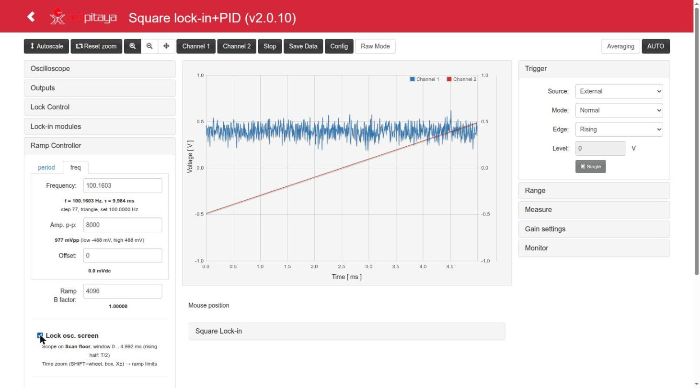

**Turning it on** (`rampLockScreenOn()`, l. 4019):

- the scope trigger becomes *Ext Trig* = **Scan floor**, *Source* = **External**, *Mode* = **Normal** (as when
  choosing an Ext Trig);
- the time window becomes the window of the table above, so t = 0 is the scan floor;
- a *Capture Lock* in progress ends first;
- the text below the checkbox shows the window and "Time zoom (SHIFT+wheel, box, X±) → ramp limits".

**Zoom while it is on** (`rampLockScreenFromX()`, l. 4054, and `rampZoomToLims()`, l. 3729):

| Action on the plot | Effect |
|---|---|
| **SHIFT + wheel**, a **box selection**, the **X− / X+** buttons of *Range* (time zoom) | New `ramp_low_lim` / `ramp_hig_lim`: the values that the ramp has at the two ends of the window zoomed. **Triangle**: the straight line of the rise, $v(t) = \mathrm{low} + \mathrm{amp}\cdot t/(T/2)$, also outside 0 … T/2 (zoom out, pan). **Sawtooth**: the straight line of the sawtooth, extended outside 0 … T. The **frequency of the whole period is kept** (step recomputed with the new N) and the window goes back to the new T/2 (triangle) or T (sawtooth), so the zone chosen fills the screen. |
| The Y part of a box selection | Zooms Y (only in the page), as usual. |
| A box over the **whole width** of the view (within 2 % at each end) | No time zoom: the ramp does not change, only Y is zoomed (`rampZoomIsView()`, l. 3754). |
| **Wheel without keys** | Y only (normally it zooms both axes); **ALT + wheel**: Y only, as before. The registers do not change. |
| **Reset zoom** | Gives the window of Lock osc. screen again. |

The result is limited to −8192 … 8191 with at least 1 count of amplitude.

Measured on the board (v2.0.10, triangle ±4000 at 100 Hz, Channel 2 = Ramp A; each row starts from the result of the
previous one; the model is $v(t)$ above; identical to `lock_in+pid_harmonic` 2.3.31):

| Action | low / hig (model) | step, f | New window |
|---|---|---|---|
| Box 1.0024 … 2.5040 ms | −2394 / 13 (−2393.6 / 12.8) | 259, 99.869 Hz | 0 … 5.007 ms |
| SHIFT + wheel out at 2.5 ms | −2994 / 617 (amplitude ×1.500, centre −1190.5 → −1188.5) | 100.048 Hz | |
| SHIFT + wheel in at 1 ms | −2754 / −347 (model −2753.2, the point at 1 ms fixed) | | |
| X+ | −3954 / 853 | 100.014 Hz | |
| X− | −2512 / −589 | 100.004 Hz | |

With a **sawtooth** the window is one whole period (checking *Sawtooth* with the freq tab or Lock osc. screen on keeps
the frequency: 100 Hz ±4000 → step 155, window 0 … 9.985 ms). With *Scan direction* = 0 the sawtooth jumps to the high
limit after the floor and falls (seen on the board, the same `gen_ramp.v` as always); the time zoom follows that line.

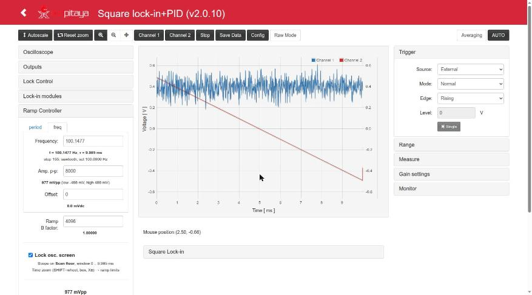

**The window follows the ramp**: any change of step, limits or waveform (either tab, the wheel on the fields,
another client, a config load) sets the window again (only when the ramp changed; `rampLockScreenSync()`, l. 3984).
The trace is cleared only if the window really changes: a zoom that keeps the frequency keeps the acquisition in
progress. Windows longer than 68.7 s are clamped to the longest memory (shown in the text).

**Slow scans / continuous update** (acquisition windows ≥ 1.5 s, the `long_acq` regime of `src/worker.c` in which
the trace is published while it is acquired, see [Slow scans](#slow-scans)):

- armed in Normal on the scan floor, the trace always starts at the floor and **grows to the right**; with a
  triangle it reaches the top at T/2, stays still for the other half period and starts again from the floor;
- the time zoom uses the model of the ramp, not the samples, so it works with an incomplete trace; after a zoom the
  acquisition in progress (old limits) ends and the next one starts at the next floor of the new ramp.

Example (v2.0.10, 0.2 Hz triangle ±4000, T = 5 s): window 0 … 2.5 s; the last sample of the trace moved 1.20 → 1.80 →
2.20 → 2.50 s and in the next scan started again at 0.20 s.

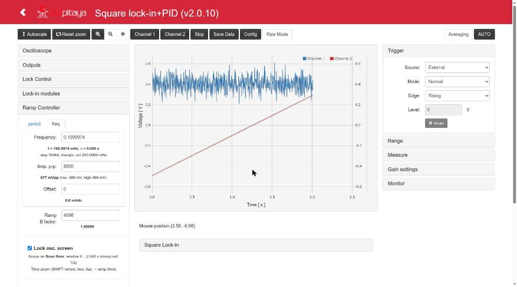

**Turning it off** (`rampLockScreenOff()`, l. 4041):

- unchecking it: the trigger (External / Normal / Scan floor) and the time window **stay as they are**; only the
  normal time zoom of the plot comes back (SHIFT + wheel zooms the view again, without touching the ramp; on the board
  −1.248 … 6.24 ms);
- choosing another *Source*, *Ext Trig* or *Mode* in the page (also *Mode* = Single), pressing **AUTO**
  (`serverAutoScale()`, l. 6868), or pressing **Single** (`singleUpdate()`, l. 6363) also turns it off, with the same
  rule (trigger and window kept, the choice of the user applied);
- it is **not saved** in the configs (it is a state of the page: after a reload it is off).

**With Capture Lock** ([Lock Control](#lock-control)): during a capture *Lock osc. screen* is suspended (the
capture uses its own trigger and window; the wheel zoom is only in the page, as for any capture) and when the
capture ends it comes back with its window; ending the capture with **Single** turns it off (above).

The screenshot of the panel before v2.0.10 (v2.0.4, no tabs; `lock_mode` with OscA = Ramp A, OscB = in1: ±5000
counts (±610 mV, 1221 mVpp), period 400, triangle → τ = 64.16 ms, f = 15.59 Hz; the two peaks of in1 (≈ 0.5 V) are
seen on the way up and on the way down):

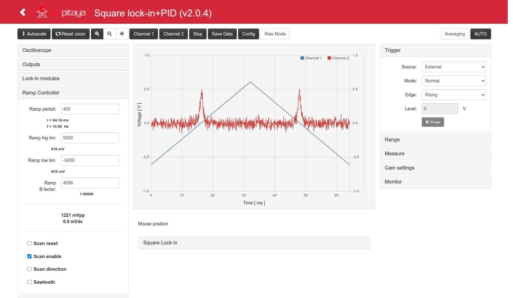

### PIDs modules

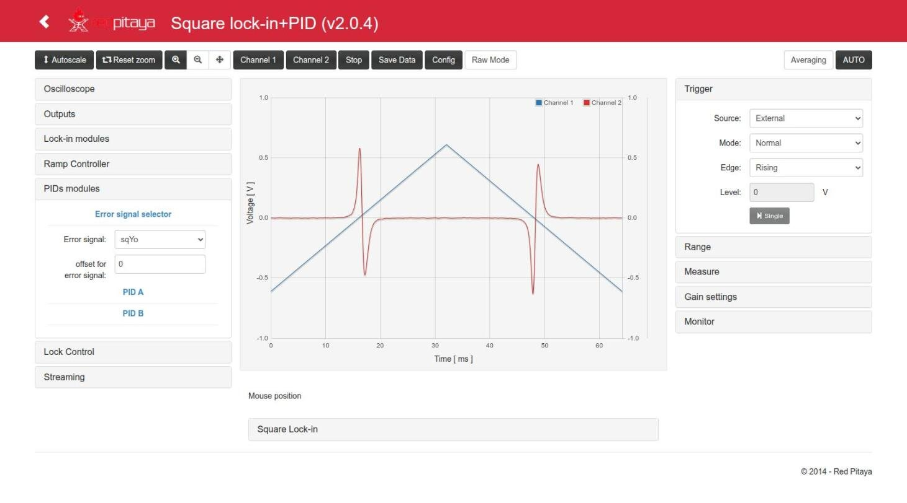

- **Error signal selector**: *Error signal* (0, sqXo, sqYo, sqFo, signal_i, in2, in1, in1−in2) and its *offset*
  (subtracted).
- **PID A / PID B**: *input* (error, sqXo, sqYo, sqFo, signal_i, Ramp A, in1−in2, in1, in2, aux_A, aux_B, sq_ref,
  sq_quad, sq_phas), *reset integral*, *freeze out*, *freeze integral*, and the gains *kp*, *ki*, *kd* with the
  effective value written below (kp as a factor, ki and kd as τ and f).
- **More Options** shows the set point *sp*, the scale selectors of kp (/1../4096), ki (8 ns..9 s) and kd
  (7.5 ns..491.5 µs), and *SAT lim* (saturation of the integral term, ±122 µV..±1 V).

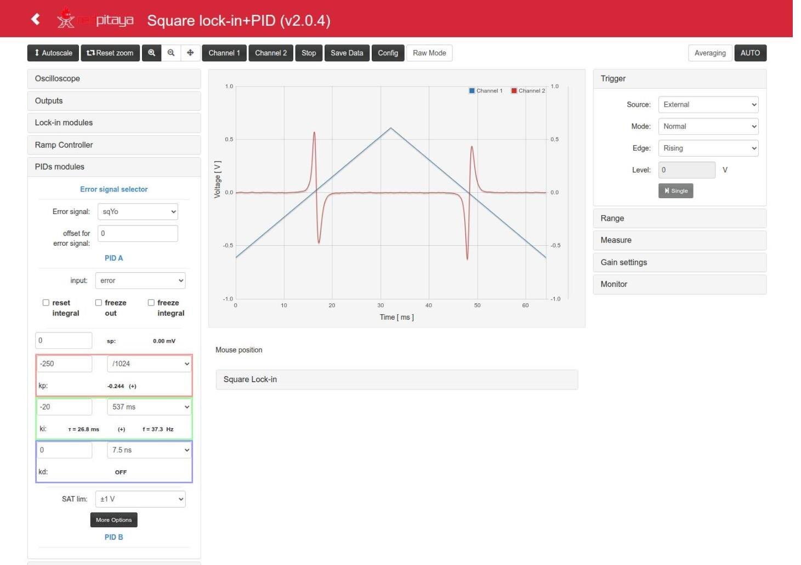

In the example (`lock_mode`) kp = −250 with /1024 gives −0.244, and ki = −20 with 537 ms gives τ = 26.8 ms
(f = 37.3 Hz); kd = 0 (OFF), SAT ±1 V.

### Lock Control

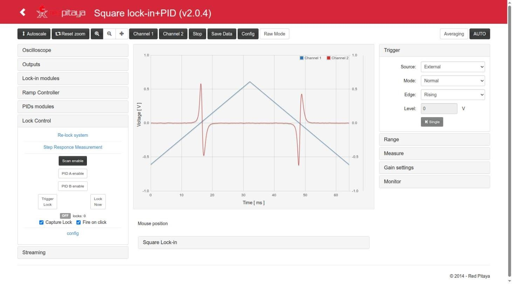

The main part of the panel (from top to bottom):

- **Scan enable / PID A enable / PID B enable**: buttons with the **effective** state of the ramp and the
  PIDs (dark = on). When nothing is locked a click toggles the manual enable; while LOCKED a click
  releases the lock keeping the other enables.
- **Trigger Lock**: arms the lock; it closes when the trigger of the *config* section happens (time,
  level or level+time). **Lock Now**: closes the lock at once. Both stay pressed while requested; a second
  click releases the lock.
- **time / level / time+level** (the three small colored buttons between Trigger Lock and Lock Now; since
  v2.0.7): a shortcut for *Trigger type* + *Choose from graph* + *Fire on click*. Click one (it stays filled while
  it waits, the cursor over the plot is a crosshair and a short note covers the state label and the checkboxes
  below), then click on the plot: the trigger type is set, the time
  and / or level are taken from the click, and *Trigger Lock* fires at once (with *Capture Lock* if checked, even if
  *Fire on click* is unchecked). An active lock is kept until that click, then released and armed again. Esc or a
  second click on the same button cancels.
- **State label**: OFF / ARMED / LOCKED and the number of locks since the FPGA was loaded.
- **Capture Lock** (on by default): every lock request from the page captures the closing of the loop in
  the scope and freezes the trace. **Fire on click** (on by default): with *Choose from graph*, a click on
  the plot sets the trigger value and fires *Trigger Lock*. Design: [`lock_capture.md`](../lock_in+pid_square/doc/lock_capture.md).
- **config** (open it with its title):

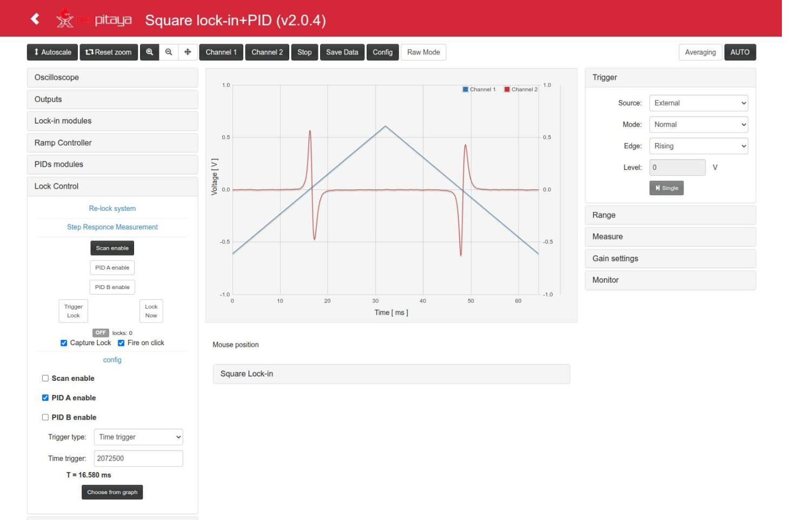

  - *Scan enable*, *PID A enable*, *PID B enable*: what is on **while LOCKED** (usually: scan off, PID A on).
  - *Trigger type*: OFF (only Lock Now), Time trigger, Level Trigger, Level+time Trigger.
  - *Time trigger*: delay after the scan floor, in ticks of 8 ns or with units (`16.58 ms`, `20 s`); shown as T
    below (2072500 = 16.580 ms in the screenshot and in `lock_mode`). 0 = OFF, up to 4294967295 = 34.36 s.
  - *Signal for trigger* (error, sqXo, sqYo, sqFo, signal_i, Ramp A, aux_A, in1, in2, in1−in2, PID A out, PID B out,
    ctrl_A, ctrl_B, Ramp B, aux_B), *Level trigger* (counts or `V`/`mV`, shown in mV below), *trig upward?*.
  - **Choose from graph**: the next click on the plot sets the time (and/or level) of the trigger. A second
    click on the button (*Cancel*) or Esc cancels it. A red warning appears if the scope is not in
    Normal/Single + External + Scan floor (the only setup where t = 0 of the plot is the scan floor):

- **Re-lock system** and **Step Responce Measurement** (open them with their titles):

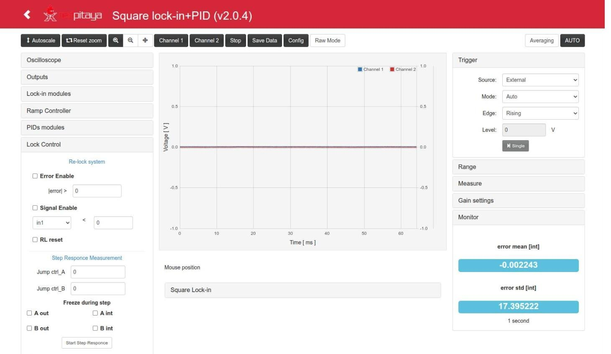

  In the screenshot the loop is closed (LOCKED with the Time trigger, then Trigger Mode Auto): ctrl_A and error are
  flat, and the Monitor shows error mean −0.0022 and std 17.40 counts (≈ 2.1 mV, kp = −250, error = sqYo ×32).

  - Re-lock: *Error Enable* with `|error| >` threshold, *Signal Enable* with a signal (in1, in2, in1−in2, aux_A,
    aux_B, sqXo, sqYo, sqFo) `<` threshold, *RL reset*. Not tested on this version (see
    [App.md](App.md#re-lock-and-step-response)).
  - Step response: *Jump ctrl_A*, *Jump ctrl_B*, *Freeze during step* (A/B out, A/B int), *Start Step Responce*.

How the lock control works inside: [`lock_control.md`](../lock_in+pid_square/doc/lock_control.md) and
[Structure.md](Structure.md#lock-control).

### Streaming

- **IP** (the *IP* button fills in the address of the computer running the browser), **Port** (6000 for
  the server of `resources/streaming`), **Streaming Rate** (1.95 MS/s .. 1.9 kS/s; 0.98 MS/s is the fastest
  continuous rate: 976 kS/s with overrun 0 on the board with this App).
- **Prepare Streaming** starts `c/streaming` on the board; **Start** / **Stop** send the data of the two scope
  channels (OscA, OscB).
- Start the receiver on the computer first (`resources/streaming/server`, or `nc -l <port>`); details in
  `resources/README.md`.

### Right panels and displays

- **Trigger**: *Source* (Channel 1, Channel 2, External), *Mode* (Auto, Normal, Single), *Edge*, *Level* (in V, or in
  ADC counts in Raw Mode, −8192 … 8191, since v2.0.8), and the *Single* button. External uses the *Ext Trig* of the Oscilloscope panel.
  **Auto** (since v2.0.5) waits for the trigger as *Normal* does (the *Level* of the source channel, or the
  *Ext Trig* with Source = External) and forces an acquisition only when no trigger comes within a time limit:
  the largest of 0.25 s, 1.1 × the window + 50 ms and, when the period of the Ext Trig is known (Scan floor /
  Scan ceil with the scan running, Square mod.), 1.1 × that period + 50 ms; at most 80 s. So with Ext Trig = Scan
  floor, t = 0 is the scan floor in Auto too (a 30 s scan in a 0…29.4 s window waits up to 33 s and every scan is
  acquired from its floor), and without a trigger (scan stopped or locked with the ramp off, Ext Trig None, a level
  the signal never crosses) the traces keep coming: every 0.25 s plus the acquisition for short windows. As before,
  an Auto acquisition starts at the trigger (no negative times). Up to v2.0.4 Auto triggered at once, at any phase
  of the scan (Scan floor seemed to trigger at the ceiling). The *Level* field and line work in Auto too.
- **Range**: buttons for the X and Y scales and offsets (X+ up to 68.7 s).
- **Measure**: min, max, amplitude, average, frequency and period of each channel.
- **Gain settings**: probe attenuation (1x/10x) and LV/HV jumper setting of each input (scale of the display).
- **Square Lock-in** (below the plot, opened with its title): **sqX**, **sqY**, **R** = $\sqrt{\mathrm{sqX}^2+\mathrm{sqY}^2}$,
  **φ** = atan2(sqY, sqX) and **sqF**, with bars. They are computed from the 28-bit registers **before the
  amplification** (`sq?_28 / 2^13` counts, shown in V with 8192 counts = 1 V; in Raw mode in counts): a square input
  of amplitude A in phase with `sq_ref` reads A; a sine of amplitude A reads (2/π)·A·cos φ. The values of sqXo /
  sqYo / sqFo seen on the scope are these multiplied by the *Amplification*.
- **Monitor**: mean and standard deviation of the error over ~1 s, in counts.

(The Square Lock-in display opened has no screenshot yet.)

### Slow scans

With windows of 1.5 s or more (e.g. a 30 s ramp) the scope reads its memory while the FPGA is still writing it.
Since v2.0.3 (port of `lock_in+pid_harmonic` v2.3.23, see the CHANGELOG):

- **Reset zoom** on a scan of period T ≥ 1.5 s (Ext Trig = Scan floor / Scan ceil / Square mod.) sets the window
  to 0 … 0.98 × T (at least 50 ms before the next trigger), so that the scope is armed again in time and every scan
  is acquired. Shorter periods keep one whole period. The rising half of a triangle (second click with Scan floor,
  v2.0.10) is 0 … T/2: it already ends half a period before the next floor, so no 0.98.
- **Lock osc. screen** (v2.0.10) uses 0 … T/2 with a triangle and the same window as Reset zoom (0 … 0.98 × T) with a
  sawtooth, and keeps it when the ramp changes; its time zoom works on an incomplete trace
  ([Lock osc. screen](#lock-osc-screen)).
- The trace is drawn **while it is acquired**, only with valid points of the current acquisition (it starts and
  ends at the valid ones, never mixed with an older lap of the memory, and the previous trace is not left to the
  right). In Normal mode the **whole trace is only seen near the end of each scan**: between the end of the
  window (0.98 × T) and the next scan floor.
- **Capture Lock** works with slow scans (Time trigger, Level trigger and Lock Now): the lock request is held until
  the scope has loaded its **history before the lock** (the part of the window before t = 0; banner "loading the
  scope history before the lock (x s)"), then the lock is applied and the capture is drawn as it is acquired.
  Lock Now on a slow window therefore locks after that history, on purpose.
- (FPGA) A time trigger armed after the ramp was stopped (e.g. right after releasing a lock) waits for the next
  scan floor instead of firing in the middle of the scan.

(A slow scan with this App: the 0.2 Hz triangle of [Lock osc. screen](#lock-osc-screen), v2.0.10. See also the
screenshots of `lock_in+pid_harmonic`, whose scope is the same:
[its Usage.md](https://github.com/marceluda/rp_lock-in_pid_h/blob/master/doc/Usage.md#slow-scans).)

## Typing values with units

Five fields are text fields that accept a number with a unit (decimal point or comma, optional space, units not
case sensitive). The value is converted and sent when the edit ends (Enter or leaving the field); then the field is
rewritten in register units and the text below it is updated. Escape restores the previous value. An empty or
invalid text (`abc`) is not sent: a red hint appears and the last value comes back. The mouse wheel changes the value
by one tick / count.

| Field | Without unit | Units | Examples (checked on the board, 2.0.0-5) |
|---|---|---|---|
| Lock Control → Time trigger | ticks of 8 ns | `s` (`seg`), `ms`, `us` (`µs`), `ns`, `tick(s)`; 0 .. 4294967295 (34.36 s), clamped | `16.58 ms` → 2072500, `40 s` → 4294967295 |
| Lock Control → Level trigger | counts | `V`, `mV`, `count(s)`; −8192 .. 8191, clamped | `120 mV` → 983, `abc` → not sent |
| Square oscillator → Half period | `gen_mod_sqp` | a frequency `Hz`, `kHz`, `MHz` (nearest possible value) or a period `s`, `ms`, `us`, `ns` | `31.25 MHz` → 1, `50 kHz` → 1249, `20 us` → 1249 |
| Square oscillator → Phase | ticks | `deg` (`°`), `rad`, `pi` (`π`): fraction of the current period; or a delay `s`, `ms`, `us`, `ns` | `90 deg` → 625 at 50 kHz, `0.5 pi` → 625 |
| Ramp Controller → Ramp period (tab *period*, since v2.0.10) | `ramp_step` | the whole period of the ramp: `s` (`seg`), `ms`, `us`; 0 .. 2147483520, nearest step | `10 ms` → 77 (triangle ±4000), 155 (sawtooth), `4294967295` → 2147483520 (board, 2.0.10-20) |

Sources: `index.html` `parseTrigTime()`, `parseTrigLevel()` (l. 2486-2497), `input_unit_parsers` (l. 2500-2503,
with `rampStepParseField()` of the Ramp period), `parseSqPeriod()`, `parseSqPhase()` (l. 2529-2574),
`lock_modulation_update()` (l. 2578); tests `test/trig_input_units_sim.js` (case 10: Ramp period),
`test/sq_modulation_ui_sim.js`, `test/ramp_ui_sim.js`. The fields of the *freq* tab of the Ramp Controller accept units
too (*Frequency* in Hz / kHz / mHz…, *Amp. p-p* and *Offset* in counts or `mV` / `V`; [Tabs period and
freq](#tabs-period-and-freq)).

- The frequency typed is converted to the nearest **integer** half period, without forcing it odd: `1 MHz` gives
  `gen_mod_sqp` = 62 (992.1 kHz, quadrature 88.6°, with the warning); type 61 for 90° (1.008 MHz). The Python
  helper `set_freq_hz()` picks the nearest odd value by itself ([Remote.md](Remote.md#lock-in-pid-ramp-and-lock-helpers)).
- The angle of the Phase is converted with the period in the Half period field at that moment: change the period
  first, then the phase.
- Values above $2^{24}$ (Time trigger above 134 ms, Half period above 16777216 i.e. below ~3.7 Hz) go through the float
  parameters of the C controller: written from the page they are rounded to the float32 grid; written from Python
  through `/lock` they are exact and kept (the page shows the rounded echo, but does not rewrite the register unless
  that field is changed in the page). Above $2^{24}$ the parity of the half period cannot be seen from the page, so no
  quadrature warning is shown (error < $10^{-6}$ degrees).

 

The other numeric fields (`<input type="number">`) only accept numbers. The JavaScript still has conversions for them,
but the browser does not give a text with letters to the page (`.val()` is empty), so those conversions can not be
reached from the UI (the same was found for *Ramp period* in `lock_in+pid_plus` 2.2.0-rc2, CHANGELOG v2.0.10):

| Field | Conversion in the code | Usable from the page |
|---|---|---|
| Ramp hig / low lim | `V`, `mV` → counts (`lock_ramp_step_update()`, l. 2121-2139) | no (use *Amp. p-p* / *Offset* of the *freq* tab) |
| PID A / B sp | `V`, `mV` → counts (l. 2249-2254, 2356-2361) | no (not tested on the board) |

## Procedures

These procedures follow `test_files/lock_test.md` (Apps folder), the procedure used to test every version on the
board, with the configuration of this App `test_files/lock_in+pid_square__lock_mode.json`: a system with a resonance
(a peak) whose control input is OUT1 and whose response is measured on IN1. All the numbers below come from that
configuration and from the test of 2026-10-12 ([lock test report](../../reportes/lock-in_pid_sq_lock_test/2026-10-12_01:00:00_lock.md),
in the Apps folder).

### 1. Scan and see the response of the system

1. **Outputs**: Out1 = `ctrl_A`.
2. **Ramp Controller**: limits ±5000 (±610 mV), period 400 (triangle: 64.16 ms), *Scan enable* checked.
3. **Lock Control**: *Scan enable* button on, *PID A enable* off.
4. **Oscilloscope**: OscA = `ctrl_A` (or `Ramp A`), OscB = `in1`; Ext Trig = *Scan floor*.
5. **Trigger**: Source *External*, Mode *Normal* (picking an Ext Trig already sets them, v2.0.4). Press
   **Reset zoom**: the window goes from 0 to one period of the ramp (0 … 64.16 ms) and t = 0 is the scan floor;
   a second click gives the rising half (0 … 32.08 ms, since v2.0.10) if you want more detail around the peak. The
   preset `in1|ctrl` sets in1 on Channel 1 and ctrl_A on Channel 2 in one click.

The response of the system (the peak) appears on Channel 2 at the same position in every sweep (16.25 ms after the
scan floor in the test, ctrl_A ≈ +70 counts).

Alternatives since v2.0.10: in step 2 use the **freq** tab (e.g. Frequency `15.59 Hz`, Amp. p-p 10000, Offset 0), or
type `64.16 ms` in *Ramp period* (gives step 400); and instead of step 5 check **Lock osc. screen**, which sets the
trigger and the window of the rising half of the triangle (0 … 32.08 ms: each peak of the response appears once) in
one click. Then a **box selection** (or SHIFT + wheel) around the peak narrows the scan to that zone at the same
frequency: the peak gets wider on the screen, which is a quick way to find the limits of a scan for the lock
([Lock osc. screen](#lock-osc-screen)). Without Lock osc. screen, a second click of *Reset zoom* also shows the rising
half ([Reset zoom](#reset-zoom-whole-period--rising-half)).

### 2. Configure the square lock-in to get an error signal

The lock-in, with a small square modulation added to the control signal, gives a signal proportional to the
derivative of the response with respect to the scan: it crosses zero at the maximum of the peak, which is the error
signal for the PID.

1. **Lock-in modules**: Lock-in input = `in1`.
2. **Square oscillator**: Half period = `50 kHz` (→ 1249, quadrature 90°), Phase = 0. The frequency has to be inside
   the bandwidth of the system (here the simulator has a ~20 kHz low-pass filter at its input: 50 kHz still passes
   attenuated, 31.25 MHz does not; see [Working at 31.25 MHz](#5-working-at-3125-mhz)). That filter also sets the phase
   of the response: with it turned off the response at 50 kHz is in phase and the error is sqXo instead of sqYo.
3. **Auxiliar → Square Modulation Amplitude**: *A Out1* = 100 (±50 counts ≈ ±6 mV added to OUT1), *A Out2* = −1.
4. **Demodulation → sqX & sqY**: filter 262 µs | 607 Hz, order 2; Amplification ×32.
5. Look at `sqXo` and `sqYo` (OscA/OscB, preset `sqX|sqY`) during the scan. In the test: sqYo went from +4933 to −3825 counts with the
   zero crossing at 16.69 ms, sqXo from +2072 to −1234 (crossing at 16.74 ms): sqYo has 2.4× more slope, so it is the
   one used. The crossing appears ~0.4 ms after the peak of IN1 because of the delay of the 262 µs 2nd-order filter
   during the scan; it does not move the lock point (static). Instead of choosing sqX or sqY, the Phase can be
   adjusted so that sqFo has the largest slope.
6. **PIDs modules**: Error signal = `sqYo`, offset 0.
7. OscA = `ctrl_A`, OscB = `error` (preset `ctrl|err`; see the [Oscilloscope](#oscilloscope) screenshot).

### 3. Close the lock

1. **PID A**: input = error, kp = −250 (/1024), ki = −20 (537 ms). The sign of the gains has to give negative
   feedback around the zero crossing (here sqYo > 0 before the peak, so negative gains; try the other sign if the
   lock runs away).
   The reference configuration `lock_mode` uses kp −250 since 2026-10-12 (user's decision: with −500 the loop of the
   harmonic Apps was close to oscillating); the 50 kHz test of 2026-10-12 01:00 quoted below was done with kp −500.
2. **Lock Control → config**: while locked, *PID A enable* on and *Scan enable* off.
3. Choose the trigger:
   - **Time trigger**: press *Choose from graph* and click on the zero crossing of the error (16.56 ms →
     2070178 ticks in the test). With *Fire on click* on, the click also fires *Trigger Lock*.
   - Shortcut: press the small **time** (or **level**, **time+level**) button between *Trigger Lock* and
     *Lock Now* and click on the plot: type, value and *Trigger Lock* in one go (steps 3 and 4).
   - **Level trigger**: Signal for trigger = error, Level = a value of the error just before the crossing,
     *trig upward?* according to the slope. In the test 4000 counts (488 mV, upward): the maximum of sqYo was ~4930,
     so the 5085 of the harmonic App would never be reached.
   - **Lock Now**: locks immediately wherever the ramp is (useful only when the system is already near the
     point).
4. Press **Trigger Lock**. The state goes OFF → ARMED → LOCKED in the next sweep; with *Capture Lock* the
   scope shows the closing of the loop (t = 0 is the lock, ctrl_A blue, error red) and keeps it frozen, with the
   banner "Lock captured (t = 0: lock, 16.6 ms after the scan floor)":

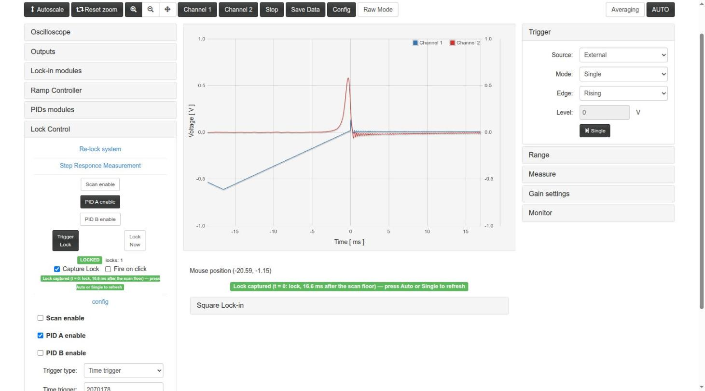

With the level trigger the capture uses the window the scope had (here the 130 µs left by AUTO):

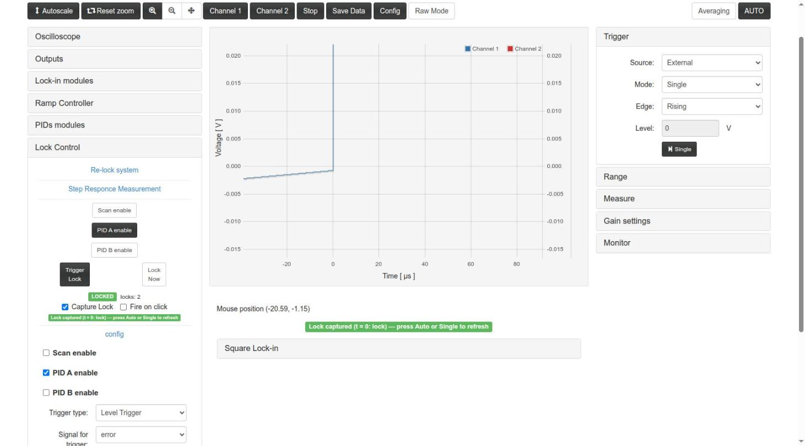

*Choose from graph* with *Fire on click* sets the time and fires the lock in one click (GIF, v2.0.4, `lock_mode`
with kp −250): scan with Time trigger 2072500; *Choose from graph*; click on the zero crossing (16.58 ms) → LOCKED,
capture frozen; *Choose from graph* on the frozen capture and a click at t = −1.03 ms (**Fire on click**) → new lock
with Time trigger 1944048 (T = 15.552 ms, "15.6 ms after the scan floor"), the loop brings the error back to 0;
Mode Auto (flat traces); a second click on *Trigger Lock* releases and the scan comes back:

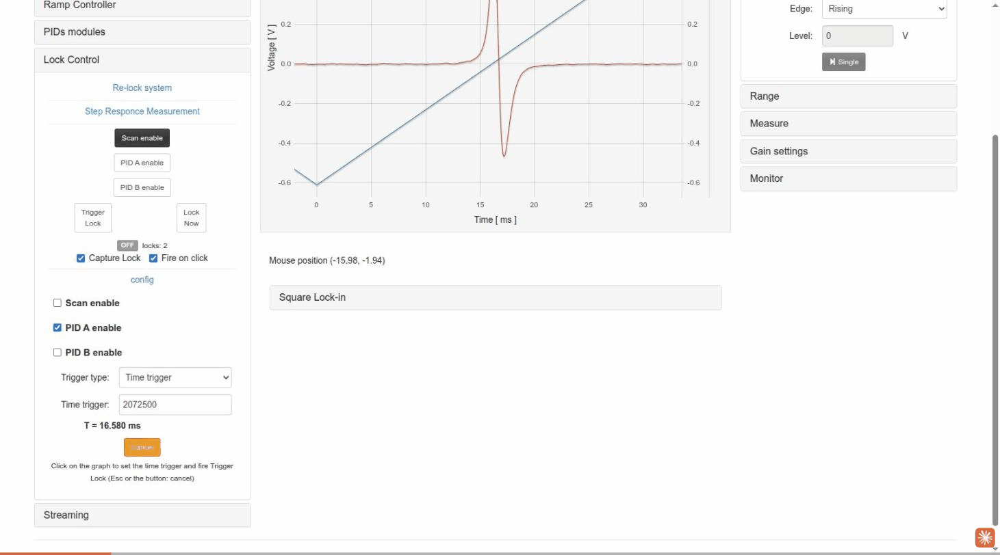

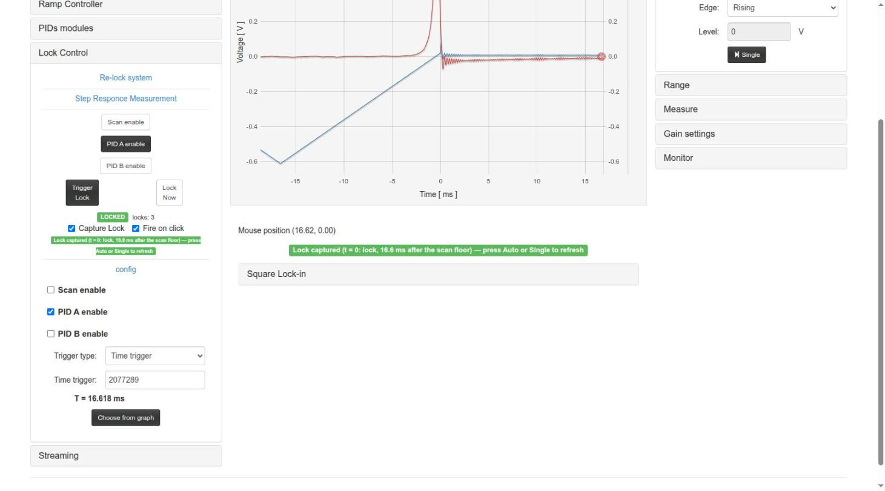

The frozen capture ends (and the scope settings saved before the capture are restored) with trigger mode
Auto/Normal, *Single*, **AUTO**, a change of source or Ext Trig, unchecking *Capture Lock*, or a release
while waiting. *Autoscale* keeps it. While the capture is frozen the page sends nothing (0 POST in 63 and 87 s in
the test).

### 4. Check the lock and release it

1. Set the trigger Mode to **Auto** (or press AUTO): the ramp has stopped and ctrl_A and the error stay constant.
   With a short window the residue of the 50 kHz modulation is seen (±1.5 mV on ctrl_A, ±3 mV on the error):

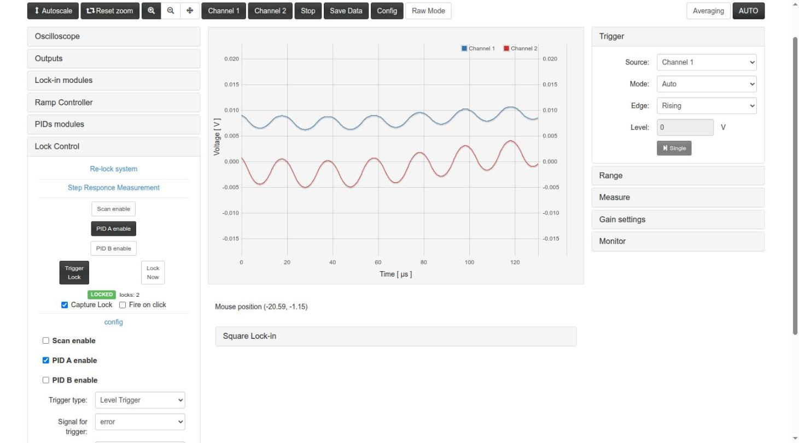

2. With OscA = `in1` the signal stays at the top of the peak (0.97–0.98 × the peak in the test; it fluctuates with
   the response to the modulation).
3. The **Monitor** panel shows the mean (≈ 0) and the std of the error (≈ 21–25 counts ≈ 2.6 mV with sqYo ×32 in the
   test with kp −500; 17.40 counts ≈ 2.1 mV with kp −250 in the [screenshot](#lock-control) of v2.0.4).
4. **Release**: a second click on *Trigger Lock* (or *Lock Now*), or a click on *Scan enable* (restarts the
   scan with the PIDs as they were).

Results of the test (2.0.0-5 and 2.0.0-6): 5/5 locks, ctrl_A 8.5–8.8 mV at the lock point (the same point as with
the harmonic App), 88 s, 134 s and 16 s locked until released by hand ([App.md](App.md#lock-control-auto-lock)).

A lock can also be closed and checked without the web page, with `py/lock_from_registers.py` on the board or over
HTTP (see [Remote.md](Remote.md)); the page follows the state without sending anything.

### 5. Working at 31.25 MHz

Half period = 1 (`31.25 MHz`) is the highest frequency with quadrature (4 ticks per period). A lock at this frequency
was tested on the board on 2026-10-12 (2.0.0-6 on RP2, against `dummy_simulator` on RP1; configuration
`test_files/lock_in+pid_square__lock_mode_31MHz.json`,
[report](../../reportes/lock-in_pid_sq_lock_test/2026-10-12_14:00:00_lock_31MHz.md) in the Apps folder). It is
procedures 1–4 with these changes:

| Setting | 50 kHz (`lock_mode`) | 31.25 MHz (`lock_mode_31MHz`) |
|---|---|---|
| Square oscillator → Half period | 1249 (`50 kHz`) | **1** (`31.25 MHz`) |
| Phase | 0 | 0 |
| A Out1 | 100 (±50 counts) | **200** (±100 counts, a sine of ≈ ±127 counts after the DAC) |
| sqX & sqY amplification | ×32 | **×2** (with ×32 or ×8 sqYo saturates at ±8192) |
| sqX & sqY filter | 262 µs, order 2 | 262 µs, order 2 |
| Error signal | sqYo | sqYo |
| PID A | kp −250 (/1024), ki −20 (537 ms) | same (same sign: sqYo > 0 before the peak at both frequencies) |
| Time trigger | 2072500 (16.58 ms) | **2075000** (16.6 ms); *Choose from graph* gave 2063067 (16.505 ms) |
| Level trigger | 4000 (488 mV) | **2000** (244 mV, upward): sqYo only reaches ≈ ±3000 with ×2 |

During the scan sqYo goes from +3071 to −2775 counts with a single zero crossing at the peak (16.76 ms); sqXo is
smaller (+611 / −804) and wavy, so sqYo with phase 0 is the error and neither sqFo nor another phase was needed:

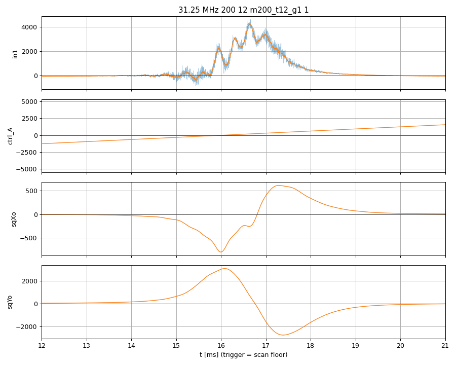

With the time trigger chosen on the graph the lock closes in the next sweep and Capture Lock keeps the closing of the
loop (ctrl_A blue, error red):

Result: Time and Level trigger, 70 s each without losing the lock, error −1.0 ± 3.8 counts, ctrl_A 8.9 mV (the same
point of the peak as at 50 kHz); details in [App.md](App.md#lock-control-auto-lock).

The same lock was repeated with v2.0.10 (2026-11-13, regression of the web page; report
`reportes/lock-in_pid_sq/2026-11-13_1503_v2010.md`): the configuration loaded with *Load file* (107 parameters), the
error sqYo +0.36 … −0.33 V with its zero crossing at ~16.5 ms, *Trigger Lock* (time) OFF → LOCKED with the capture
"16.6 ms after the scan floor"; in Auto, 20 s: ctrl_A $7.02 \pm 0.19$ mV, error $-0.04 \pm 0.69$ mV; 10 s: IN1
$249.9 \pm 56.9$ mV, with the known beat of ~2.1 kHz (below). Same lock point and IN1 as on 2026-10-12.

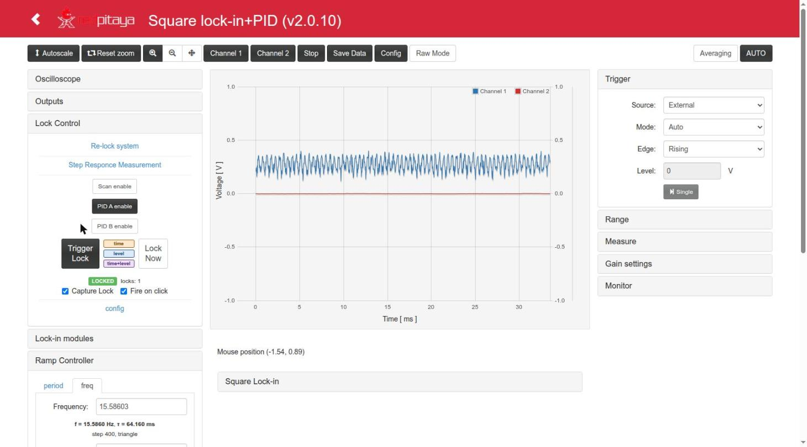

Things to know:

- **The system under test must have enough bandwidth.** With the input low-pass filter of `dummy_simulator`
  (~20 kHz) on, nothing comes back at 31.25 MHz; the test was done with that filter turned off (`dummy_lpf_on` = 0 on
  RP1). The same applies to a real system: the modulation has to reach the response.
- **The signal at the output is not square**: the DAC samples +A, +A, −A, −A are those of a sine of amplitude
  ≈ 1.27·A after the DAC ([App.md](App.md#square-modulation-generator)).
- **IN1 does not show the top of the peak while modulating.** With A Out1 = 200 the modulation (≈ ±127 counts) is
  comparable to the width of the simulated peak, so the mean of IN1 while locked is ≈ 0.5 × the peak (≈ 2000 counts).
  With the loop closed and A Out1 = −1 (modulation off, the error stays at 0 and the PI holds) IN1 = 3781 ± 42 counts,
  the height of the peak: the lock is at the maximum. To find the peak in the scan use the zero crossing of the error
  and ctrl_A, not the shape of IN1, which is deformed by the modulation and by the beat below.
- **Beat between boards without a common clock.** The two Red Pitayas have independent 125 MHz crystals
  (≈ 17 ppm apart in the test): the simulator samples the 31.25 MHz signal (fs/4) with its own clock and a component
  at ≈ 2.1 kHz appears on IN1 and on sqX/sqY with short filters. The 262 µs 2nd-order filter removes it from sqYo (std
  0.0 counts outside the peak); while locked a residue of ±3 counts at ~2–3 kHz remains on the error. So, although the
  product at 31.25 MHz has its AC part at 62.5 MHz and a filter of a few hundred ns would remove it, with this kind of
  setup the filter cannot be that short (shorter than 262 µs was not tried with the loop closed). A setup sharing
  the clock would not have the beat (a confirmar).
- **Longer filters delay the crossing during the scan**: with 1.05 ms the zero crossing moved ~2 ms with respect to
  the scan (it does not move the static lock point, but it moves the time trigger to choose).
- **The Phase only has 4 values** (0, 90°, 180°, 270°). Use sqX, sqY and the R | φ of the Square Lock-in display to
  see the real phase of the signal, and choose the component (or the sign of the PID gains) accordingly. The analog
  path adds a delay: each 8 ns is 90° at this frequency. In the test bench phase 0 / sqYo was the right choice.
- The fluctuation of ctrl_A while locked is small (1.2–1.5 counts rms) because the slope of the error is much larger
  than at 50 kHz.

**Note on 50 kHz with the simulator filter off.** The phase of the response at 50 kHz in the test bench comes mostly
from the ~20 kHz input filter of `dummy_simulator`. With that filter off the response at 50 kHz is almost all in phase:
sqXo saturates (±8192, crossing at 16.70 ms) and sqYo is small (+168 / −587); the error would then have to be sqXo
instead of sqYo (not tried with the loop closed). The configuration `lock_mode` (sqYo) assumes the filter on.

## Saving and loading configurations

**Config** opens the configuration dialog:

- *Save in browser* stores all the parameters (and the Capture Lock / Fire on click preferences) under the
  *Config Name* in the browser (`localStorage`, key `lockConfig_lock_in+pid_square`, own key of this App: the
  configs of lock_in+pid / lock_in+pid_harmonic are not shown nor imported, their lock-in parameters are different).
  *Save as file* downloads a JSON.
- The list shows the saved configs with *del*, *download* and *load*. *Load file* adds a JSON file to the list
  (then press its *load*). The test configuration `test_files/lock_in+pid_square__lock_mode.json` (Apps folder) is
  such a file.
- **Don't turn on PIDs and Ramp on config loading**: **unchecked by default** (since v2.0.5; up to 2.0.4 it was
  checked). Unchecked, *load* (also of a *Load file*) sets the ramp (*Scan enable* and the Lock Control ramp
  enable) and the PIDs as they are in the config: a config saved while scanning loads scanning. Checked, a loaded
  config never turns them on (useful when the outputs are connected to an experiment). The same option applies to
  the restore of the last config / tab state after a start / *Restart*. A lock request (*Lock Now*, *Trigger Lock*) is never
  loaded. The option is not saved: every page load starts with it unchecked.
- Configs are per browser, not stored on the board.
- **Load last config on init** (since v2.0.6): **checked by default**; the choice is kept in the browser
  (`localStorage`, key of this App). The page saves the current settings automatically every ~2 s (the *last
  config*, also in `localStorage`). Checked, each time the page starts the App (main menu, new tab, F5) it restores
  the last config; unchecked, the App starts with its defaults. The ramp / PIDs of the restored config follow the
  option above; a lock request is never restored.
- **Load last config** / **Reset to defaults** (since v2.0.6): close the dialog and restart the App (the page reloads,
  the FPGA is reloaded: outputs and lock are reset) with the last config / with the default parameters of the App (as
  a fresh start: lock open, ramp stopped, PID gains 0), whatever the checkbox says. After *Reset to defaults* (or an
  open with the box unchecked) the last config is kept until a parameter is changed, so *Load last config* brings it
  back.
- A load sends the whole config (148 keys in 5-9 POST in the test) except the read-only values, applies the time
  window of the config in the units it was saved with, and ends a frozen lock capture.
- *Lock osc. screen* and the active tab of the Ramp Controller are not saved in the configs (v2.0.10). A load changes
  the ramp, so with *Lock osc. screen* on the window follows it.

## Saving data

*Save Data* gives the data of the plot as Python/Numpy vectors, Matlab/Octave vectors or CSV (save as a
file, copy or show).

## Several clients and Restart

Only one browser tab should control the board. When another client (another tab, the main menu, another
App) takes the board, the page stops polling and shows a dialog:

*Restart* restarts the App and restores the state of this tab (with *Load last config on init* checked or not) (if the other client loaded the same App,
the FPGA is not reloaded). With this App a `bazaar?stop` from outside was detected, and the page relaunched the App
and restored its registers and the streaming IP in 7.8 s (`reportes/lock-in_pid_sq.md` step 6). On Ecosystem 2.0
the page also enters a "cautious mode" when the board answers slowly, and waits until it answers fast again.

## Known limitations of the interface

- The **Slow outputs** selectors have no effect (and list harmonic names); the **R|Phase Mode** button is disabled.
- *Time trigger* and *Half period* values above $2^{24}$ set from the page are rounded to the float32 grid.
- *Ramp hig lim* / *Ramp low lim* (tab *period*) do not accept `mV` / `V`: they are `<input type="number">` fields
  ([Typing values with units](#typing-values-with-units)); use *Amp. p-p* / *Offset* of the *freq* tab.
- The mouse wheel over *Ramp period* does not move the step above $2^{24}$ (16777216 steps; with N = 16000 a period of
  ≈ 2147 s): the parameter travels as a float32, and ±1 rounds back to the same value (granularity 2 … 128 there). At
  the maximum 2147483520, wheel −1 sends 2147483519 and 2147483520 comes back (seen on `lock_in+pid_plus` 2.2.0-rc2,
  same code). Typing a value or a period works. (The wheel of the *freq* tab already moves to the next float32 step.)
- After a **reload of the page with a slow scan running** (windows ≥ 1.5 s, continuous update), the X axis follows the
  trace while it grows (0 … 0.2 → 0 … 4.2 s) instead of staying on the window; *Reset zoom* fixes it (seen on
  `lock_in+pid_plus` 2.2.0-rc2, same code; not checked with this App).
- `loadParams()` keeps the window of the plot in the parameters only when its minimum is not 0
  (`if(options.xaxes[0].min && options.xaxes[0].max)`, `index.html` l. 5540): with a window that starts at t = 0 the
  parameters take the `xmin` / `xmax` of the server instead of those of the plot. Up to v2.0.9 this let a repeated
  *Force X* undo a wheel / box zoom made from t = 0 before its POST; since v2.0.10 the *Force X* is filtered
  ([Structure.md](Structure.md#time-window-of-the-plot-and-force-x)), but the rule of `loadParams()` is unchanged
  (pending for devAgent).
- Each change made in the page is a `POST /data`, and on Ecosystem 2.0 each one leaves an open connection in the
  nginx of the board; after ~1000 the board stops answering until nginx is restarted
  ([Remote.md](Remote.md#known-issue-of-the-ecosystem-post-data-leaves-connections-open)).
- Level+time with the time after the level crossing stays ARMED (the level crossing has to happen after
  the time).
- After an acquisition from Python (`acquire()` + `scope_auto()`) the page goes back to Auto in 1–2 s; if a field of
  the page is being edited (focus) it is applied when the edit ends. Once (2.0.0-5) the page stayed in "Single":
  press AUTO or click outside the field (CHANGELOG, v2.0.0).

These items are listed for devAgent in `docAgent.md` (Apps folder).
